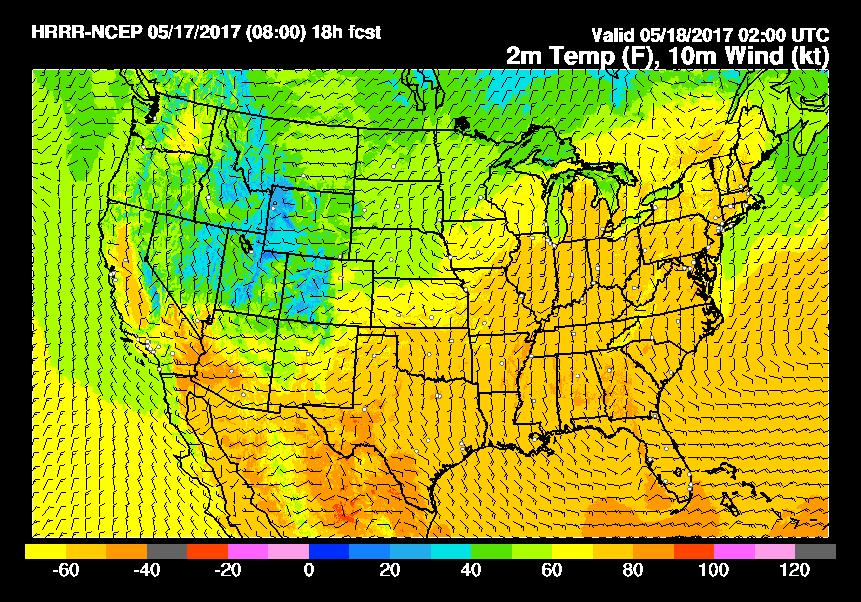
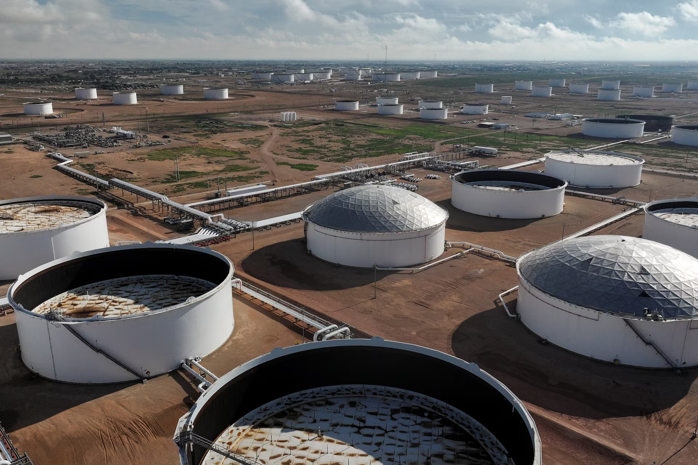
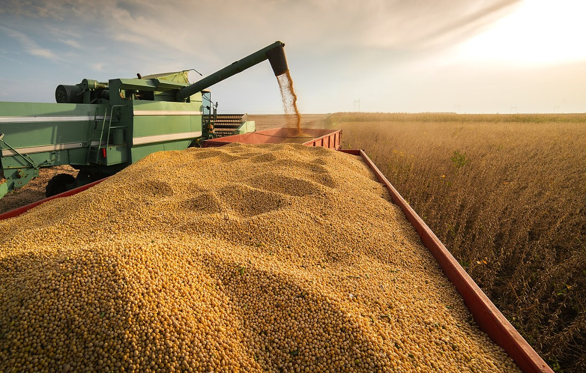

# Commodity Research

A Python workspace for commodity data, analytics, and market-specific research. All views and research in this repository are my own and sourced from public materials and data. 

## Project layout

| Directory | Purpose |
| --- | --- |
| `config/` | Project settings and market calendars |
| `data/raw/` | Local source data and downloads |
| `data/lake/` | Local processed data and analytical datasets |
| `dags/` | Standalone Airflow workflows |
| `notebooks/` | Research and visualizations |
| `src/comm_research/infra/` | Shared HTTP, lake storage, locking, and path infrastructure |
| `src/comm_research/common/` | Analytics shared across markets: math, curves, and models |
| `src/comm_research/markets/` | Market-owned scrapers, transforms, pipelines, models, analytics, and query adapters |
| `src/comm_research/dashboard/` | Shared dashboard server, chart engines, and workspace UI |

See [repository architecture](docs/architecture.md) for ownership rules, the new
scaffolds, canonical imports, and compatibility paths. Local data and `.env` are
excluded from Git.

## Local data lake

Processed datasets follow the market package taxonomy under `data/lake/`, for
example `power_gas/napg/caiso/<dataset>/`. Partition time-based
Parquet data by year and month; use a daily partition only when it avoids tiny files.

```text
data/
├── raw/                         # Source downloads, retained as needed
├── state/                       # Job checkpoints and manifests
└── lake/
    ├── power_gas/
    │   ├── napg/
    │   │   └── caiso/
    │   │       ├── dam_lmp/
    │   │       └── dam_load_forecast/
    │   └── eupg/
    ├── weather/
    │   └── forecasts/
    ├── oil/
    │   └── crude_flows/
    └── ags/
        └── crop_progress/
            └── year=YYYY/
```

Use `year=YYYY/month=MM/` partitions for most datasets. Keep query fields such as
timestamps, locations, and symbols in the Parquet data rather than adding them to
the directory path. Forecast datasets can use `run_date=YYYY-MM-DD/` when forecast
runs need to remain distinct.

## CAISO OASIS ingestion

The incremental runner covers eight OASIS categories, streams progress to the
terminal, and resumes downloads into daily Parquet partitions. Install and run a
three-day SP15 day-ahead price sample:

```bash
python -m venv .venv
.venv/bin/python -m pip install -e .
.venv/bin/python -m comm_research.markets.power_gas.napg.caiso.pipelines.oasis \
  --categories prices --datasets dam_lmp --nodes TH_SP15_GEN-APND \
  --start 2026-10-01 --end 2026-10-04
```

See [OASIS usage and data fields](docs/markets/power_gas/napg/caiso/caiso_oasis.md) for `run()` configuration,
retention/publication limits, recovery, storage, and the report catalog. The
[ingestion notebook](notebooks/markets/power_gas/napg/caiso/caiso_oasis_ingestion.ipynb)
uses the same pipeline; previous notebook paths remain available as links.

## Desk dashboard

Inspect local lake datasets with cached CAISO history, local chart controls,
and a dockable workspace:

```bash
.venv/bin/python -m pip install -e '.[dashboard]'
.venv/bin/python server.py
```

The workstation uses port **8000**. CAISO prices preload into in-memory DuckDB
at startup; node histories are cached in the browser for local range selection,
zoom, pan, and component visibility. Use `--lake /path/to/lake` or `--port` to
choose another lake or port. See [CAISO workstation](docs/markets/power_gas/napg/caiso/caiso_workstation.md).
The general-purpose Polars dashboard remains available with `python app.py`
on port 8502; see [generic analytics](docs/dashboard.md).

## Documentation

See [docs/](docs/) for infrastructure and model documentation.

## Markets

### Power & Gas

Spark spreads, nodal congestion, economic dispatch, renewables


### Weather

Statistical methods for weather and atmospheric modeling



### Oil

Crack spreads, crude, distillates, liquids



### Agriculture

Crush spreads and crop progress, satelite models



For focused DAM/RTM/FMM backfills, use `python scripts/fetch_caiso.py --help`; see
[the CLI guide](docs/markets/power_gas/napg/caiso/fetch_caiso.md) for inclusive dates, node selection and refresh behavior.
