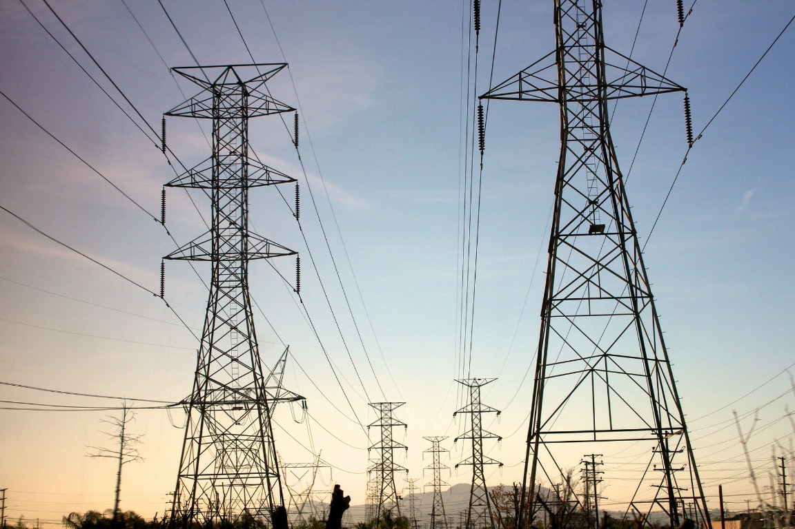
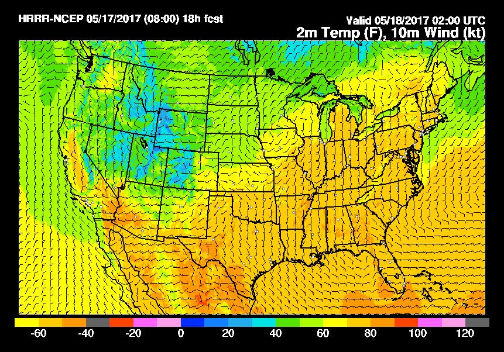
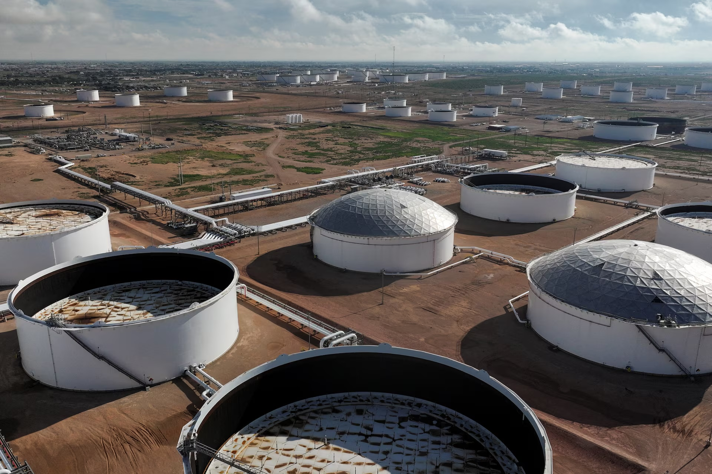
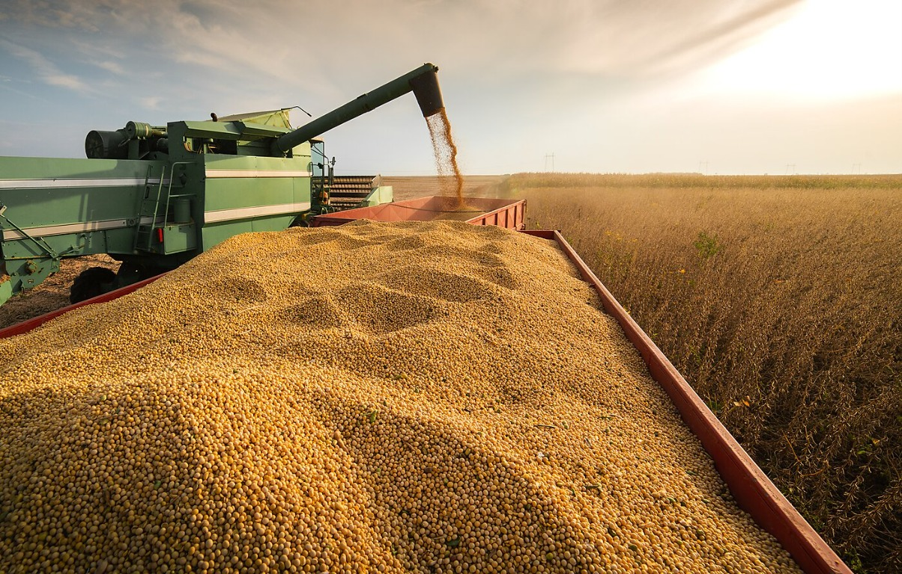

# Commodity Research

A Python workspace for commodity data, analytics, and market-specific research. All views and research in this repository are my own and sourced from public materials and data. Most of the repository is infrastructure and model code, but research notebooks can be viewed in `notebooks/`

The local research data API is available as `import datalake`; see the
[DataLake usage guide](setup/docs/datalake.md) for discovery, reads, writes,
and exports on the existing local files.

See [setup/docs/](setup/docs/) for infrastructure and model documentation, [notebooks/](notebooks/)

## Markets

### Power & Gas

Spark spreads, nodal congestion, economic dispatch, renewables

### Weather

Statistical methods for weather and atmospheric modeling

### Oil

Crack spreads, crude, distillates, liquids

### Agriculture

Crush spreads and crop progress, satelite models

For focused DAM/RTM/FMM backfills, use `python src/comm_research/markets/power/scripts/oasis.py --help`; see
[the CLI guide](setup/docs/markets/power/fetch_caiso.md) for inclusive dates, node selection and refresh behavior.
