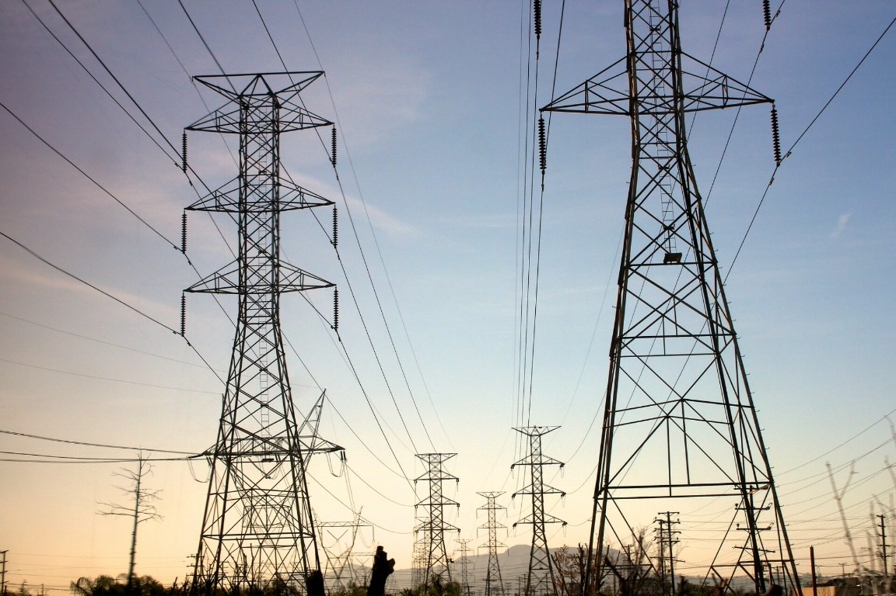
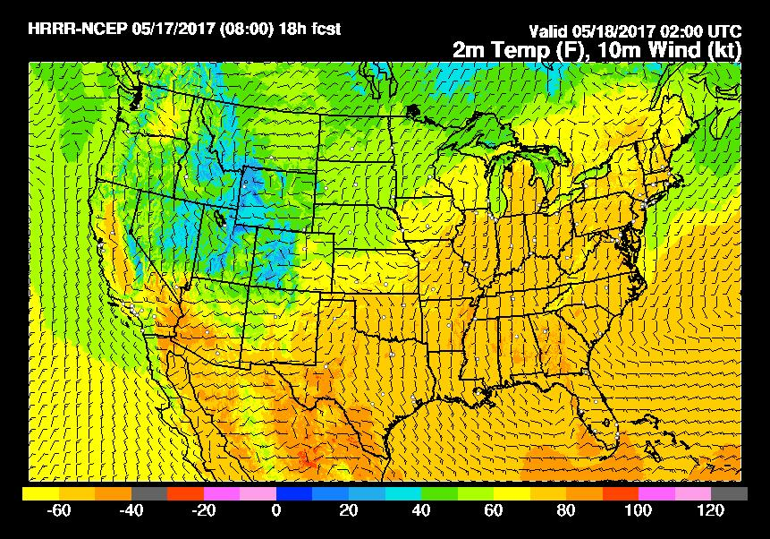
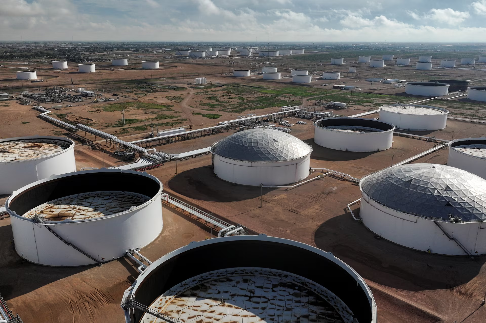
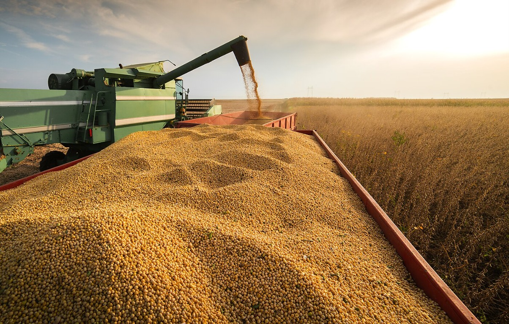

# Commodity Research

A Python workspace for commodity data, analytics, and market-specific research. All views and research in this repository are my own and sourced from public materials and data. Most of the repository is infrastructure and model code, but research notebooks can be viewed in `notebooks/`

The local research data API is available as `import datalake`; see the
[DataLake usage guide](setup/docs/datalake.md) for discovery, reads, writes,
and exports on the existing local files.


See [setup/docs/](setup/docs/) for infrastructure and model documentation, [notebooks/](notebooks/)

## Markets

### Power & Gas

Spark spreads, nodal congestion, economic dispatch, renewables



### Weather

Statistical methods for weather and atmospheric modeling

Use `weather.plot` to export an interactive map from a pandas or Polars
DataFrame, including the frame returned by `DuckDBClient.get_data`.

```python
from comm_research.markets import weather
from infra.database.duckdb_client import DuckDBClient

db = DuckDBClient()
df = db.get_data("ecmwf_hourly")
weather_plot = weather.plot(
    df,
    metric="value",
    regions=["us48", "europe"],
    title="ECMWF Hourly Temperature Forecast",
    subtitle="Contiguous U.S. and Europe",
)
```

The [example notebook](notebooks/examples/spatial_weather_map.ipynb) writes
`data/outputs/weather/us48-europe.html` and returns its absolute path. Open it
in a browser to scrub through valid times, hover for coordinates and values,
and switch temperature units with the °F / °C / K buttons. The file works
offline. Pass `output_dir` to change where it is saved. Use `regions=[]` to fit
the available grid, mask water, and save it as `weather.html`.

The plot infers UTC valid times, coordinates, and units from the input. For
raw ECMWF rows, **Latest** combines the latest cycle available for each
region. **Include history** shows every available valid time, using the newest
cycle that covers that time in each region. Both views use the lowest-numbered
available ensemble member for each forecast time. A region goes gray when it
has no data at the selected time. For a preselected grid, provide one row per
valid time, latitude, and longitude. The `us48` preset clips to the lower 48 states
and DC. The `europe` preset follows Natural Earth boundaries for European
countries, Turkey, and Cyprus within the available forecast window. Regions
share a color scale across all timestamps. Water, land outside the selected
regions, and cells between grid tiles are transparent.

Use `comm_research.markets.weather.vis.SpatialMap` to customize the Bokeh
layout, including explicit column names, color limits, and clipping.

CONUS geography comes from the U.S. Census Bureau's 2024 1:5,000,000
cartographic state boundaries. The state polygons were dissolved in geographic
coordinates, projected from NAD83 (EPSG:4269) through WGS 84 (EPSG:4326) to Web
Mercator (EPSG:3857), and simplified at 450 projected meters for both the mask
and outline. The Census coastline excludes the Great Lakes and coastal waters.
The mask retains islands present at the source scale and cuts out bundled
Natural Earth lakes wholly within the Census outline. [Census source](https://www.census.gov/geographies/mapping-files/2024/geo/carto-boundary-file.html)

Surrounding land, boundaries, inland lakes, and city locations use Natural
Earth 5.1.2 public-domain data. Context polygons and lines use 1:50m data
simplified at 0.06° and city coordinates use the 1:10m populated places file.
The boundaries and city locations are bundled for offline use. [Natural Earth terms](https://www.naturalearthdata.com/about/terms-of-use/)

To regenerate the boundary assets, install `shapely>=2.1,<3`, `pyproj`, and
`pyshp` and run the following from the repository root with `--region conus`
or `--region europe`. The directory caches the pinned source datasets.

```bash
python src/comm_research/markets/weather/vis/prepare_conus.py /path/to/source-cache --region europe
```



### Oil

Crack spreads, crude, distillates, liquids



### Agriculture

Crush spreads and crop progress, satelite models


